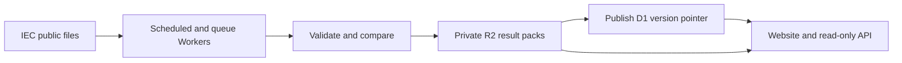

# Counted

Counted is an independent civic project by Jacques Blom that makes South African
local election results easier to find, understand and reuse. It combines a results
website with a public, read-only API and an importer for the Electoral Commission
of South Africa (IEC)'s public results feeds. It is not an official IEC service.

[Public service](https://counted.co.za) ·
[API documentation](https://counted.co.za/api) ·
[Sync health](https://counted.co.za/api/v1/sync)

## What is in this repository?

- A results explorer spanning 2000–2026 with national and provincial summaries, municipality,
  ward and voting-district pages, party vote shares and reporting progress.
- Place and address search, electoral boundary maps, council seat displays and
  a coalition explorer. Geographic matches do not establish voter registration.
- A provenance-aware REST API covering municipal elections in **2000, 2006,
  2011, 2016, 2021 and 2026**, with source URLs, timestamps and validation status.
  Historical elections are available through the API and the website’s election-year
  slider, with party vote-share changes since the immediately previous election.
- Local import/backfill tools and a scheduled Worker that keeps the 2026 results
  up to date without making visitors query the IEC directly.

The application uses **Astro, TypeScript and Cloudflare Workers**. D1 stores result
metadata, historical rows and geographic indexes; private R2 buckets store live
result packs and map assets; Cloudflare Queues handles background refreshes.
The repository includes frontend work that may be ahead of the public deployment.

Results can be provisional or incomplete. Ballot counts are not unique voters,
reporting progress is not turnout, and boundaries can change between elections.
Source discrepancies remain visible instead of being silently adjusted. Dedicated
turnout ingestion is still planned; see [turnout data](docs/turnout.md).

## Run it yourself

### Prerequisites

Use **Node 24** (the exact development version is in `.node-version`) and
**pnpm 12.16.1** (pinned in `package.json`). The importer uses Node's built-in
SQLite support. You do not need a Cloudflare account or IEC credentials for local
result development; importing data does require internet access.

```sh
git clone https://github.com/jacques-blom/sa-election-data.git
cd sa-election-data
pnpm install --frozen-lockfile
cp .env.example .env

# Start with the summary and one municipality to keep the first import small.
pnpm data:ingest --years 2026 --municipality 9909
pnpm data:load
pnpm dev:local
```

Open **http://localhost:4321**. Municipality `9909` is Witzenberg; its detail page
is `/2026/places/witzenberg`. This small import includes national/provincial summary
figures, but other municipalities' detailed results remain unavailable until you
import them. `data:load` applies the schema and copies results into local D1;
it explicitly disables remote bindings.

To import all current municipalities, or all supported elections:

```sh
pnpm data:ingest --years 2026
# Alternatively: pnpm data:ingest --years all
pnpm data:load
```

The importer writes a SQLite database and exact compressed source documents under
`.data/`. The local D1/R2 emulator uses `.wrangler/state/v3/`. Both directories are
ignored by Git and are created locally, so cloning the repository does not include
a preloaded database. Full backfills take longer and use substantially more disk
space. Rerun ingestion and loading to refresh your local snapshot; the dev server
does not start automatic IEC syncing.

### Maps and address search

Election results and the API work without a Google key. Google autocomplete,
address search and the interactive Google map require your own
`PUBLIC_GOOGLE_MAPS_API_KEY` in `.env`. Enable Maps JavaScript API and Places API
(New), and restrict the key to those APIs and your site's HTTP referrers, including
`http://localhost:4321/*` for development. This is a **browser-visible key**;
`PUBLIC_` variables are bundled into client code and must never contain server
secrets.

Detailed map previews, town/suburb relationships and coordinate-to-ward lookup
also need local boundary data and R2 map objects. They are not included in the
small result import above. Follow [the map setup and rebuild guide](docs/maps.md)
for the PMTiles basemap, ward tiles and geography imports. Rebuilding the complete
map dataset additionally requires Python 3, Shapely 2, Tippecanoe and the PMTiles
CLI. Missing map assets do not prevent the result pages from displaying figures.

If you access a remote development server through a custom hostname, set
`DEV_ALLOWED_HOSTS` in your ignored `.env` to a comma-separated list of allowed
hostnames, then start with `pnpm dev:local --host 0.0.0.0`.

### Development commands

| Command | Purpose |
| --- | --- |
| `pnpm dev:local` | Develop against your local D1/R2 data without Cloudflare authentication |
| `pnpm dev` | Maintainer mode: read live results through authenticated remote bindings |
| `pnpm check` | Regenerate Worker types and check Astro/TypeScript |
| `pnpm test` | Run unit tests and isolated local D1/R2 integration tests |
| `pnpm build` | Build the production Worker and static assets |
| `pnpm preview` | Serve the production build locally |
| `pnpm data:ingest` | Fetch the current election into the local archive |
| `pnpm data:load` | Load the archive into local D1 |
| `pnpm data:reprocess` | Reinterpret archived source files after a normalizer change |
| `pnpm data:export` | Write a SQL bootstrap for a new database; does not upload it |
| `pnpm data:logos` | Import clean IEC party artwork for locally imported 2026 results |
| `pnpm sync:dev` | Run the sync Worker locally with Wrangler's scheduled-event test endpoint |
| `pnpm sync:dry-run` | Validate the sync Worker bundle without deploying |
| `pnpm deploy:dry-run` | Build and validate the frontend Worker bundle without deploying |

`pnpm dev` is an opt-in live-data workflow in this repository: it selects the
`live` environment in `wrangler.jsonc`, whose result bindings point at the
maintainer's Cloudflare resources. It requires authorized Cloudflare access;
forks should use `pnpm dev:local` or configure their own remote resources.
Geography and map tiles stay local in that environment. See Cloudflare's
[local development guide](https://developers.cloudflare.com/workers/local-development/)
for how remote bindings differ from local emulation.

## MCP access

AI clients can read the same stored results through the public, read-only
Streamable HTTP endpoint at `/mcp` when running this version. See
[MCP setup and design](docs/mcp.md) for its sixteen tools, result images, page aggregates, API docs and Python analysis
guide, methodology resource, client configuration and deployment settings.
No API key or separate skill/plugin installation is needed.

## How IEC syncing works

The source catalogue in [`src/lib/data/catalogue.ts`](src/lib/data/catalogue.ts)
maps each election year to its IEC event ID. It reads the public municipal
results dashboard's `MapsJason` files: `EEID{eventId}LiteMapsNational.js` for the
summary and `EEID{eventId}Munic{municipalityId}.js` for municipality details. Despite
the `.js` extension, the responses are parsed as JSON and never executed.
The summary is useful for discovery and progress, but has limited party lists;
municipality documents contain the published party, ward and voting-district
results. See the [IEC dashboard](https://results.elections.org.za/dashboards/lge/).



1. **Discover changes every minute.** A Cron Trigger fetches the 2026 summary.
   Municipality fingerprints ignore report-generation timestamps so a clock-only
   rebuild does not trigger unnecessary result updates. Previously discovered
   municipalities are retained if the index temporarily omits them.
2. **Queue details and reconcile independently.** Changed municipalities receive
   idempotent Queue jobs. Every known municipality also becomes due for a detail
   check after ten minutes, including completed counts, to catch corrections that
   the summary did not reveal. A failed summary fetch does not prevent this
   independent reconciliation, subject to backoff and budget limits.
3. **Fetch politely and validate.** Requests use HTTP validators, timeouts, a
   shared limit of two request starts per second, and retries that respect
   `Retry-After`. The shared parser checks election/area IDs, structure, dates
   and vote counts. Older reports cannot replace newer ones; newer corrections
   are allowed to reduce totals. Invalid data leaves the last good version active.
4. **Publish a complete version.** Changed normalized results and their exact
   source bytes are packed into an indexed R2 object. After upload succeeds, a
   per-source lock and transactional D1 version-pointer switch publish the new
   snapshot. This keeps partial writes hidden and makes retries safe. Identical
   results and timestamp-only rebuilds update freshness without republishing
   result rows. Compact live retention keeps current and previous source versions.
5. **Serve stored results.** The API uses D1 lookups and small R2 byte-range reads
   for live results; historical results remain in D1. Result pages check our sync
   endpoint every 30 seconds while visible and refresh when publication or health
   changes. Visitor traffic does not create extra IEC requests.
6. **Expose freshness and failures.** `/api/v1/sync` reports heartbeat, backlog,
   errors and freshness. Successful-fetch time and the IEC's report time remain
   separate. Failed jobs retry and can reach a dead-letter queue; later
   reconciliation can recover them. Operation and CPU budgets can pause ingestion,
   with the private usage Tail Worker supplying CPU telemetry.

This is polling, so updates are not instantaneous. Normal changes can arrive soon
after the next summary poll; changes found only by reconciliation can take longer.
Upstream publication timing, queue load, retries and budget pauses all affect
freshness. National, provincial and municipality files can have different report
times. Always read the source timestamp and health status with the figures.

The CLI importer uses the same catalogue and validation rules but runs on demand,
one request at a time with a default 500 ms interval. Its raw archive is retained
locally, and `data:load` publishes to local D1. It does not update the deployed
service. The production sync Worker owns live writes there. For recovery,
normalizer changes and operational details, see [ingestion](docs/ingestion.md)
and [the operating budget](docs/cost-budget.md).

## Deploy your own instance

Local development is the quickest way to contribute. Hosting a complete instance
requires your own Cloudflare account and resources. The checked-in account and
resource IDs identify the maintainer's deployment; they are not credentials and
do not grant access. Replace them before deploying a fork.

1. Authenticate Wrangler to your account and update `wrangler.jsonc`,
   `workers/sync/wrangler.jsonc` and `workers/usage/wrangler.jsonc` with your account,
   Worker names and D1/R2 bindings. The deployment scripts currently select a
   profile named `personal`; create your own profile with that name or adjust the
   scripts. The optional `scripts/usage.ts` report also contains an account ID.
   For a fork, set your public origin in `src/lib/site.ts` and update
   `MCP_ALLOWED_HOSTS` in both environments in `wrangler.jsonc`. Counted uses
   `https://counted.co.za` for public metadata, share links and MCP result links.
2. Provision a shared D1 database, private result and map R2 buckets, a refresh
   Queue and a dead-letter Queue. Keep binding names such as `RESULTS_DB`,
   `RAW_RESULTS`, `MAP_TILES` and `RESULT_JOBS` aligned with the code. Keep the
   sync and usage Workers' public HTTP routes disabled.
3. Import the desired elections locally, run `pnpm data:export`, and load that
   bootstrap into your **new** remote D1 database. Follow the
   [bootstrap instructions](docs/ingestion.md#moving-the-backfill-to-cloudflare-d1).
   Do not overwrite an actively syncing database with a bootstrap export.
4. Build and upload the map objects and load the geography directory/index rows
   as described in [maps](docs/maps.md#deployment). Local loaders never provision
   remote data. Configure your own Google browser key and referrer restrictions
   in the frontend build environment if enabling address search.
5. Run checks and dry runs, then deploy the usage Worker, frontend/API and sync
   Worker, in that order (`pnpm usage:deploy`, `pnpm deploy`, `pnpm sync:deploy`).
   Confirm real Cron/Queue activity and `/api/v1/sync` health after deployment.

The ingestion design assumes Workers Paid and includes operation budgets; it is
not a promise of a fixed bill. See [cost controls](docs/cost-budget.md). The
`live` Wrangler environment is intended for local UI development, not deployment.

## Project guide

| Path | Contents |
| --- | --- |
| `src/pages/`, `src/components/`, `src/styles/` | Website, result pages and API routes |
| `src/lib/data/` | IEC source catalogue, parsing, validation, packed reads and health |
| `src/lib/places/`, `src/lib/maps/`, `src/lib/seats/` | Place relationships, maps and seat calculations |
| `scripts/` | Local imports, reprocessing, export and data loaders |
| `workers/sync/`, `workers/usage/` | Scheduled/queued ingestion and CPU telemetry |
| `migrations/` | D1/SQLite schema changes |
| `tests/` | Unit and isolated integration tests |
| `docs/` | API contract, ingestion, maps, design and methodology |

The [API contract](docs/api.md) also generates `/api` and `/api.md`, keeping the
browsable and machine-readable documentation in sync. Start there for endpoint
examples and data semantics. See also [places](docs/places.md),
[seat methodology](docs/seats.md) and [the national overview](docs/overview.md).

## Contributing

Contributions are welcome: code, data-quality investigations, documentation,
accessibility improvements, design and bug reports all help.

**AI-assisted contributions are welcome too, provided the PR is considered and
human-checked.** Read and understand every change, verify its behaviour and source
claims, and take responsibility for what you submit. Explain the problem, why the
approach fits, and what you tested. Generated output needs the same care and review
as any other contribution.

Keep PRs focused. For code changes, run `pnpm check`, `pnpm test` and `pnpm build`;
for UI changes, also check the affected flow on mobile and desktop. Election-data
changes should preserve provenance and explain how missing values, corrections
and geographic scope are handled.

Keep credentials, `.env`, `.dev.vars`, raw archives, database copies and local
machine details out of commits. `.env.example` contains empty configuration
examples. With [Gitleaks](https://github.com/gitleaks/gitleaks) installed, scan
history with `gitleaks git . --redact` and staged changes with
`gitleaks git . --pre-commit --staged --redact`. The scanner configuration only
exempts three exact public map filenames that resemble API keys.

## License

Counted's original code and documentation are licensed under the [MIT License](LICENSE),
copyright © 2026 Jacques Blom. Third-party data and assets are not relicensed by
this license.

IEC results, government boundary data, party logos, fonts and map assets retain
their source attribution and applicable terms. See [map attribution](docs/maps.md#sources-and-attribution),
[the API source notes](docs/api.md) and the bundled font licenses. Their inclusion
does not imply endorsement by the IEC, political parties or data providers.
