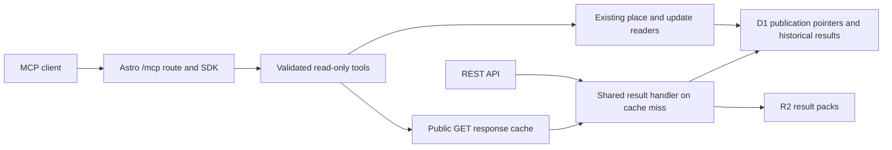

# Counted MCP

Counted exposes a public, read-only Model Context Protocol endpoint at
`https://counted.co.za/mcp`.
It uses the official TypeScript SDK v2 and Streamable HTTP, supporting the
2026-07-28 protocol and stateless 2025 clients on the same endpoint. No API key is
needed. The endpoint becomes available when this version of the app is deployed.

## Connect

Connect an MCP client to `https://counted.co.za/mcp`. For local development,
start the app with `pnpm dev:local` and use `http://localhost:4321/mcp`.
Select Streamable HTTP and no authentication. Clients that only support the old
standalone SSE transport need a Streamable HTTP adapter.

The server does not need a model provider, model API key, additional Worker,
Durable Object, database, queue or session store. Local data setup is the same as
the website: import/load results, and load the place directory for named searches.
Tool and resource discovery work even when result storage is unavailable.

To inspect the tool catalogue directly:

```sh
curl https://counted.co.za/mcp \
  -H 'Content-Type: application/json' \
  -H 'Accept: application/json, text/event-stream' \
  --data '{"jsonrpc":"2.0","id":1,"method":"tools/list"}'
```

Legacy clients initialize normally, then send independent requests without a
session ID. A response can be JSON or a Streamable HTTP SSE response; use an MCP
client to handle both. GET and DELETE return 405 because there are no standing
event streams or sessions. OPTIONS supports preflight for allowed origins.

## Tools

| Tool | Purpose |
| --- | --- |
| `list_elections` | List imported elections and health; optional `year` returns coverage for that election. |
| `search_places` | Search names and aliases; returns slugs and current geographic context. |
| `get_place` | Resolve a slug into paginated 2026 municipality/ward relationships, scope and boundary evidence. |
| `list_areas` | Discover IDs within a specified election, with level, name and parent-area filters. |
| `get_results` | Read one area's results, reported seats, provenance, freshness and quality, with paginated parties. |
| `list_sources` | Inspect source coverage, successful checks and failures for an election. |
| `get_sync_status` | Read current ingestion health without triggering a refresh. |
| `get_updates` | Follow reported milestones and linked corrections using bounded cursor pagination. |

Every tool has a strict input schema, a structured output envelope and read-only
annotations. Success returns `data`, `data_url`, `documentation_url` and
`retrieved_at`, both as structured content and JSON text for older clients.
`retrieved_at` is the tool-read time, including cache hits; it is not an upstream
freshness guarantee. Public result and documentation links use `https://counted.co.za`,
including when the MCP client connects to a local development server. Data retains
the REST schema and source timestamps.

Lists default to 20 records and allow at most 50. Offset pagination returns
`next_offset`; update pagination uses the existing `next_before` / `latest_id`
cursors. `get_results` uses `party_limit` and `party_offset`, with metadata under
`party_page`. Party rows retain source order. Only that array is sliced: source
totals, list scope, anomalies and reconciliation still describe the entire source.
Do not calculate a vote-share denominator from a page sum. Check the source
snapshot ID across party pages and restart pagination if publication changes it.

Expected data failures return `isError: true` with a safe error code, message,
status and retryability. Unknown tools and protocol errors use the SDK's JSON-RPC
errors. Missing data is not converted to zero or an empty successful result.

## Typical workflow

1. Call `list_elections` to see what is loaded.
2. For a current named place, call `search_places` then `get_place`. Read the
   geographic scope and use the returned electoral IDs with `get_results`.
3. For historical results, call `list_areas` with an explicit `year` and `query`.
   Do not reuse a current town-to-ward mapping for an older election.
4. Call `get_results` with `year`, `level` and `area_id`. Keep the source,
   freshness, provisional status, quality flags and relevant caveats in answers.
5. For current counting, check `get_sync_status` and use `get_updates` for reported
   outcomes and corrections.

The `counted://methodology` Markdown resource supplies interpretation rules.
The same essential rules are in server instructions and tool descriptions for
clients that do not expose MCP resources.

## Architecture and choices



The result handler is shared code, invoked in-process with existing bindings.
There are no HTTP requests back to this Worker and no MCP-triggered IEC fetches.
The MCP reader reuses the public GET cache and its existing 15-second live and
24-hour historical TTLs. JSON-RPC responses always use `Cache-Control: no-store`
so request IDs are never shared between clients. Named-place and update readers
perform bounded database reads. All server/transport instances are per request.

This design keeps website, REST and MCP results on the same publication and
provenance model. Eight task-specific tools provide discovery and evidence without
exposing raw SQL, arbitrary URLs, ingestion controls or a tool for every REST route.

There is deliberately no automatic cross-election comparison, derived town-only
result, estimated-seat tool or full geometry payload in the first version. Those
need their own explicit boundary, ballot, estimate and response-size contracts.
The existing website remains the place for maps and interactive coalition work.
Authentication can be added if private data or account-specific features appear;
public election data does not require an OAuth/account system.

## HTTP boundaries and deployment

`MCP_ALLOWED_HOSTS` in both Wrangler environments names the hostnames permitted
to serve this endpoint. Update it for forks, custom domains or previews. Loopback
names support local development; ports are ignored by the SDK validator.
Development also admits explicit `DEV_ALLOWED_HOSTS`. Origin-bearing requests
must use one of the allowed hostnames. Server-to-server clients normally omit
Origin. There is no wildcard CORS or credential forwarding. Browser-only MCP
clients on another origin require an intentional allowlist change.

POST bodies are limited to 32 KiB, including bodies without Content-Length.
Inputs bound years, IDs, text lengths, page sizes and offsets. No caller-supplied
URL is fetched. The endpoint advertises no write tools and opens no persistent
subscription streams. For public traffic growth, apply host-level rate limits
at Cloudflare to protect shared D1/R2 read capacity; no distributed rate limiter
is configured by this change.

Build and deploy with the existing app workflow. No new resource provisioning or
schema migration is required specifically for MCP. Result and place coverage
still depend on the app's existing data migrations and imports.

## Validation and references

`tests/mcp.test.ts` exercises both protocol generations with the official client,
discovery, origin/host guards, size limits, invalid arguments, historical lookup,
party pagination and REST parity against isolated local D1/R2 fixtures.
Run `pnpm check`, `pnpm test` and `pnpm build`; smoke-test `/mcp` in the production
preview to exercise the Workers runtime and Astro route.

The design follows the SDK's [web-standard handler](https://ts.sdk.modelcontextprotocol.io/v2/serving/web-standard.html),
[HTTP lifecycle](https://ts.sdk.modelcontextprotocol.io/v2/serving/http.html) and
[legacy compatibility](https://ts.sdk.modelcontextprotocol.io/v2/serving/legacy-clients.html)
guidance. See [the REST contract](api.md) for election-data semantics.
