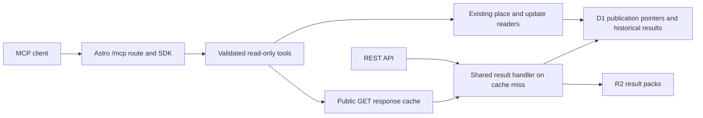

# Counted MCP

Counted exposes a public, read-only Model Context Protocol endpoint at
`https://counted.co.za/mcp`.
It uses the official TypeScript SDK v2 and Streamable HTTP, supporting the
2026-07-28 protocol and stateless 2025 clients on the same endpoint. No API key is
needed. The endpoint becomes available when this version of the app is deployed.

## Connect

The [Use Counted with AI](https://counted.co.za/ai) landing page provides ChatGPT
and Claude setup steps, a copyable server URL and short starter prompts. A
homepage callout and the site footer link to it.
These are guided connections: users finish setup in their chosen assistant.


Connect an MCP client to `https://counted.co.za/mcp`. For local development,
start the app with `pnpm dev:local` and use `http://localhost:4321/mcp`.
Select Streamable HTTP and no authentication. Clients that only support the old
standalone SSE transport need a Streamable HTTP adapter.

The server does not need a model provider, model API key, additional Worker,
Durable Object, database, queue or session store. Local data setup is the same as
the website: import/load results, and load the place directory for named searches.
Tool and resource discovery work even when result storage is unavailable.

To inspect the tool catalogue directly:

```sh
curl https://counted.co.za/mcp \
  -H 'Content-Type: application/json' \
  -H 'Accept: application/json, text/event-stream' \
  --data '{"jsonrpc":"2.0","id":1,"method":"tools/list"}'
```

Legacy clients initialize normally, then send independent requests without a
session ID. A response can be JSON or a Streamable HTTP SSE response; use an MCP
client to handle both. GET and DELETE return 405 because there are no standing
event streams or sessions. OPTIONS supports preflight for allowed origins.

## Tools

| Tool | Purpose |
| --- | --- |
| `get_api_docs` | Load the complete authoritative API Markdown, identical to `/api.md`. |
| `get_analysis_guide` | Load an analysis workflow, Python download helper URL, table schemas and comparison rules on demand. |
| `get_overview` | Read national/provincial source summaries, region cards, reporting and reported council-majority aggregates. |
| `get_area_summary` | Read calculated shares, leaders, progress, previous-election movement and labelled reported/estimated seats for one area. |
| `list_area_summaries` | Page through compact area calculations, optionally selecting one party's votes, share and history across the scope. |
| `list_elections` | List imported elections and health; optional `year` returns coverage for that election. |
| `search_places` | Search names and aliases; returns slugs and current geographic context. |
| `get_place` | Resolve a slug into paginated 2026 municipality/ward relationships, scope and boundary evidence. |
| `list_areas` | Discover IDs within a specified election, with level, name and parent-area filters. |
| `get_results` | Read one area's results, reported seats, provenance, freshness and quality, with paginated parties. |
| `list_sources` | Inspect source coverage, successful checks and failures for an election. |
| `get_sync_status` | Read current ingestion health without triggering a refresh. |
| `get_updates` | Follow reported milestones and linked corrections using bounded cursor pagination. |
| `render_results_image` | Draw one area's vote shares with reporting progress, ballot basis and source evidence. |
| `render_comparison_image` | Draw changes from the preceding election, or one party's shares across selected areas. |
| `render_council_image` | Draw council seats and a majority threshold; optionally highlight a hypothetical coalition. |

Every tool has a strict input schema, a structured output envelope and read-only
annotations. Success returns `data`, `data_url`, `documentation_url` and
`retrieved_at`, both as structured content and JSON text for older clients.
`retrieved_at` is the tool-read time, including cache hits; it is not an upstream
freshness guarantee. Public result and documentation links use `https://counted.co.za`,
including when the MCP client connects to a local development server. Data retains
the REST schema and source timestamps.

Most lists default to 20 records and allow at most 50; `list_area_summaries`
defaults to 10 areas and allows at most 25. Offset pagination returns
`next_offset`; update pagination uses the existing `next_before` / `latest_id`
cursors. `get_results` uses `party_limit` and `party_offset`, with metadata under
`party_page`. Party rows retain source order. Only that array is sliced: source
totals, list scope, anomalies and reconciliation still describe the entire source.
Do not calculate a vote-share denominator from a page sum. Check the source
snapshot ID across party pages and restart pagination if publication changes it.

Expected data failures return `isError: true` with a safe error code, message,
status and retryability. Unknown tools and protocol errors use the SDK's JSON-RPC
errors. Missing data is not converted to zero or an empty successful result.

## Generated images

All three image tools return a standard PNG image content block and the usual
structured envelope. `data` includes `image_url`, `image_markdown`, `alt_text`,
dimensions, a chart snapshot ID and the underlying chart model. `data_url` is
the immutable JSON evidence for that chart. Each tool also advertises the shared
`ui://counted/result-image-v1.html` MCP Apps resource, which shows the PNG and
download links in supporting clients. Clients without UI support can embed
`image_markdown` or link the PNG. A successful tool call does not guarantee that
a particular client displays Markdown images. Normal ChatGPT desktop was tested:
the MCP Apps viewer rendered the image; plain Markdown embeds from tool output
were blank. No Python, generated-image model or separate plugin package is needed.

- `render_results_image`: required `year`, `level`, `area_id`; optional `ballot`
  (default `auto`), `top` (3–15, default 8), and `party_id` to include/highlight.
  All denominators are calculated before choosing displayed rows.
- `render_comparison_image`: required `year`, `level`, `area_ids`; optional
  `ballot`, `mode`, `top` (3–15, default 10), and `party_id`.
  `previous_election` (default) requires exactly one area and compares against
  its preceding imported election. The chart includes measurable named parties
  in the current source, not an exhaustive accounting of parties that exited.
  Unknown baselines remain excluded; same-ID history is not boundary-adjusted.
  `areas` requires 2–12 distinct areas and a named `party_id`; it compares shares
  on the same ballot in one year and geographic level. It does not imply a
  nationwide ranking or sum the areas.
- `render_council_image`: required `year`, `municipality_id`; optional
  `selected_party_ids` (at most 20 distinct named parties). Estimates, reported
  allocations, provisional status and hypothetical selections remain explicit.
  Grouped independents cannot be treated as a single coalition partner.

PNG and JSON objects are stored under the dedicated `mcp-images/v1/` prefix in
the existing R2 bucket. Their SHA-256 keys cover the versioned chart model and
source evidence. Repeating the same model reuses the stored PNG. They are served
at `/images/results/<hash>.png` and `.json` with immutable caching, ETags and
GET/HEAD support. The route accepts only hash filenames and never exposes raw
source keys. No election records change; these are public derived artifacts.
Images are bounded to 2 MiB and model JSON to 256 KiB. Rendering uses the existing
bundled fonts and WASM renderer, with no arbitrary URLs, SVG or code as inputs.

## Typical workflow

1. Call `list_elections` to see what is loaded.
2. For a current named place, call `search_places` then `get_place`. Read the
   geographic scope and use the returned electoral IDs with `get_results`.
3. For historical results, call `list_areas` with an explicit `year` and `query`.
   Do not reuse a current town-to-ward mapping for an older election.
4. Call `get_results` with `year`, `level` and `area_id`. Keep the source,
   freshness, provisional status, quality flags and relevant caveats in answers.
5. For current counting, check `get_sync_status` and use `get_updates` for reported
   outcomes and corrections.

The `counted://methodology` Markdown resource supplies interpretation rules.
The same essential rules are in server instructions and tool descriptions for
clients that do not expose MCP resources.
The complete API contract is available through `get_api_docs` and the
`counted://api-documentation` Markdown resource. Both use the same source file as
the website, without database or external HTTP requests.

## Data behind the pages

`get_overview` accepts `year` and an optional `province_id`. It exposes national
or province source shares, reporting progress, province/metro or municipality
cards, and council-majority aggregates where available. Municipality lists are
paginated; national and province totals retain the source's leading-party scope.
Those totals are not recomputed from the subset of visible cards. Only complete,
validated, reported seat allocations enter council outcome counts. Missing or
estimated councils remain pending. A hung council does not identify its coalition.

`get_area_summary` accepts the same election/level/ID as `get_results`, plus
`ballot` (`auto`, `pr`, `ward`, `source_total`) and party pagination. It shares the
website's calculations for shares, leaders/ties, progress, history and council
seats. National/provincial summaries use combined ballots; combined-only historical
detail falls back explicitly. Council `status` distinguishes `reported`, `estimated`
and `unavailable`. Per-party raw `reported_seats` remain separate from calculated
`council_allocation`. Follow all party pages for complete allocations.

`list_area_summaries` accepts one level and parent/name filters, with an optional
`party_id`. Each area contains its ballot denominator, leader, progress, council
status, source and quality; `selected_party` adds that party's votes, share and
movement without returning every party row. Missing/ambiguous identities remain
unavailable. This is useful for passing compact, complete scopes into a client's
Python. The `data_url` links to the underlying source record or directory; these
calculated tool outputs are not new REST endpoints.

History is explicitly an exploratory same-ID comparison. An absent party is never
assigned a zero historical share when the earlier source includes OTHER. Page
calculations do not invent district-council results, town-only totals, voter
turnout, boundary-adjusted swings or actual coalition membership. Town/suburb
pages remain accessible through `get_place`'s whole-ward relationships and area
summary calls. Updates are available through `get_updates`; map geometry and
lookup endpoints are documented by `get_api_docs` rather than duplicated as tools.

## Open-ended Python analysis

Call `get_analysis_guide` before multi-area rankings, comparisons, charts or
exports. It returns versioned, skill-like instructions as an ordinary tool result;
there is no ChatGPT plugin package or installed skill. The server instructions and
tool description advertise it so agents can discover it. Loading it does not read
result storage or execute code, and does not force a client to follow the workflow.

The guide links to `/analysis/counted_data.py`, a Python 3.9+ standard-library
client. It downloads complete imported scopes through public REST GETs, with all
area/source pages and all party rows. For example, after downloading the script:

```sh
python3 counted_data.py --year 2026 --level municipality --output data-2026
python3 counted_data.py --year 2021 --level municipality --output data-2021
```

Use `--province-id`, `--municipality-id` or `--ward-id` to narrow coverage, and
`--base-url http://localhost:4321` for a local deployment. Output must be a new
directory with an existing parent. Results are `results.jsonl` (lossless API
records), `areas.csv`, `parties.csv`, `sources.json` and a completion manifest with
coverage, snapshot IDs, timestamps and file hashes. Source versions are checked
before/after capture, as is area membership; incomplete pages, duplicate areas or
changed snapshots fail without publishing a complete dataset. HTTP failures have
bounded retries and requests run serially. The manifest describes imported scope,
not completed counting, national coverage or verified boundary comparability.

Python can then calculate arbitrary statistics over those files. It must preserve
missing values, separate ballot types, retain aggregate rows in denominators and
check historical comparability. A “biggest winners/losers” question needs a stated
metric (for example PR percentage-point change since 2021), equivalent coverage,
and provisional-status caveats. The guide explains these rules without hardcoding
a particular ranking into the MCP.

The agent needs a real file-transfer path into its Python environment. Returning
a URL does not grant network access or attach a file. Network-enabled Python can
download directly; other clients need a host download facility or to save complete
MCP pages. Client sandbox restrictions still apply.

## Architecture and choices



The result handler is shared code, invoked in-process with existing bindings.
There are no HTTP requests back to this Worker and no MCP-triggered IEC fetches.
The MCP reader reuses the public GET cache and its existing 15-second live and
24-hour historical TTLs. JSON-RPC responses always use `Cache-Control: no-store`
so request IDs are never shared between clients. Named-place and update readers
perform bounded database reads. All server/transport instances are per request.

This design keeps website, REST and MCP results on the same publication and
provenance model. Sixteen task-specific tools provide discovery and evidence without
exposing raw SQL, arbitrary URLs, ingestion controls or a tool for every REST route.

There is no boundary-adjusted cross-election comparison, derived town-only result,
caller-code execution or full geometry payload in the tool catalogue. Page history
and seat estimates retain their explicit ballot, estimate and response-size contracts.
The existing website remains the place for maps and interactive coalition work.
Authentication can be added if private data or account-specific features appear;
public election data does not require an OAuth/account system.

## HTTP boundaries and deployment

`MCP_ALLOWED_HOSTS` in both Wrangler environments names the hostnames permitted
to serve this endpoint. Update it for forks, custom domains or previews. Loopback
names support local development; ports are ignored by the SDK validator.
Development also admits explicit `DEV_ALLOWED_HOSTS`. Origin-bearing requests
must use one of the allowed hostnames. Server-to-server clients normally omit
Origin. There is no wildcard CORS or credential forwarding. Browser-only MCP
clients on another origin require an intentional allowlist change.

POST bodies are limited to 32 KiB, including bodies without Content-Length.
Inputs bound years, IDs, text lengths, page sizes and offsets. No caller-supplied
URL is fetched. Generated public charts are cached in R2; election data is read-only.
The endpoint advertises no business-data write tools and opens no persistent
subscription streams. For public traffic growth, apply host-level rate limits
at Cloudflare to protect shared D1/R2 read capacity; no distributed rate limiter
is configured by this change.

Build and deploy with the existing app workflow. No new resource provisioning or
schema migration is required specifically for MCP. Result and place coverage
still depend on the app's existing data migrations and imports.

## Validation and references

`tests/mcp.test.ts` exercises both protocol generations with the official client,
discovery, origin/host guards, size limits, invalid arguments, historical lookup,
party pagination and REST parity against isolated local D1/R2 fixtures.
`tests/analysis-client.test.ts` runs Python fixture tests for full pagination,
null/identity/provenance preservation, stable snapshots and rejected partial captures
(Python 3.9+ is required to run this test).
Run `pnpm check`, `pnpm test` and `pnpm build`; smoke-test `/mcp` in the production
preview to exercise the Workers runtime and Astro route.

The design follows the SDK's [web-standard handler](https://ts.sdk.modelcontextprotocol.io/v2/serving/web-standard.html),
[HTTP lifecycle](https://ts.sdk.modelcontextprotocol.io/v2/serving/http.html) and
[legacy compatibility](https://ts.sdk.modelcontextprotocol.io/v2/serving/legacy-clients.html)
guidance. See [the REST contract](api.md) for election-data semantics.
